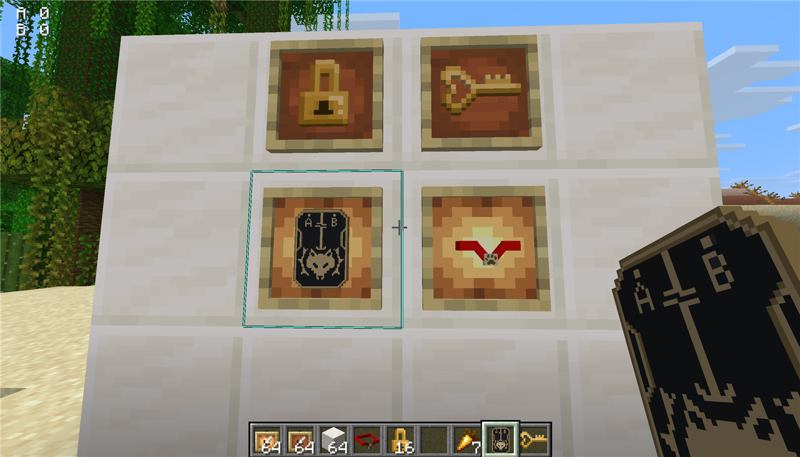
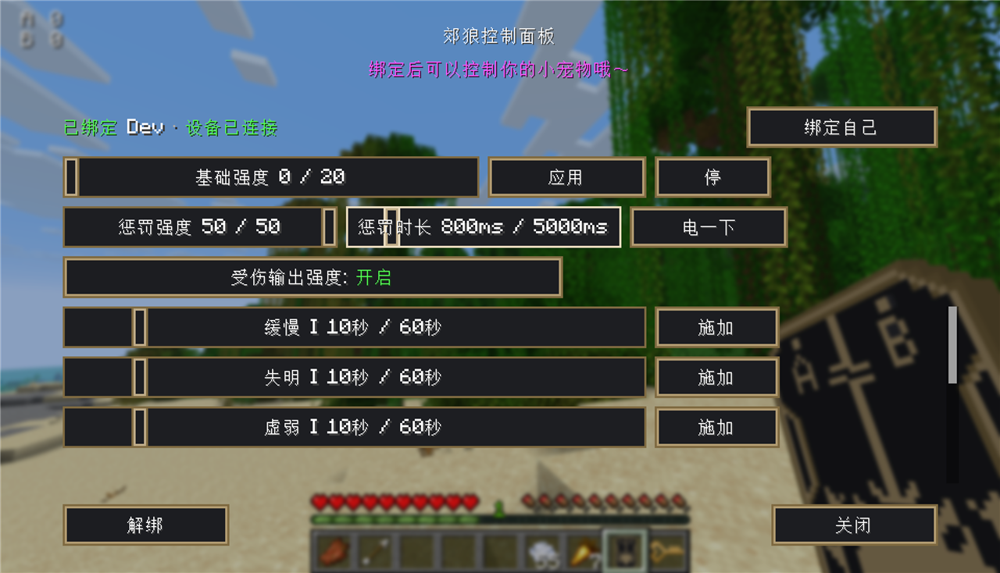
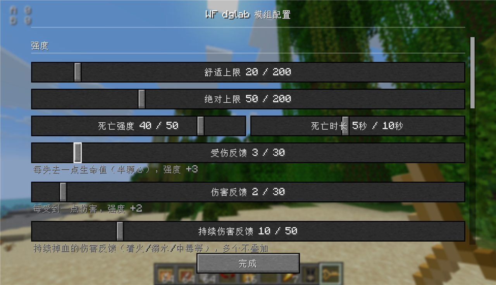

# WF dglab

适合多人游玩和相互控制的 DG-LAB 联动模组。

把游戏里的受伤、掉血、摔落，以及主人下发的强度，实时映射到郊狼（DG-LAB）设备输出上。
支持单人自我约束，也支持两人互相绑定，相互控制（服务端和客户端都需要安装）。

**Minecraft 26.3** · Fabric

## 环境要求

| 项目 | 版本 |
| --- | --- |
| Minecraft | 26.3 |
| Fabric Loader | >= 0.20.1 |
| Java | >= 25 |
| Fabric API | 对应 26.3 的版本 |
| [Trinkets](https://modrinth.com/mod/trinkets-updated) | >= 4.2.0 |

注意必须有 **Trinkets Updated** 前置模组，否则启动会报错并提示安装。

可安装 [Mod Menu](https://modrinth.com/mod/modmenu) 21.0.0：支持在模组列表里配置。
游戏里默认按 **B** 打开模组配置，快捷键均可更改或清除。

## 物品

四个物品都在「红石」分类下，生存模式配方也归在红石页（配方书里能看到）：

- **控制项圈** —— 戴在 Trinkets 的「项链」槽，和胸甲不冲突
- **项圈锁** —— 锁死项圈，锁上后不能挣脱
- **项圈钥匙** —— 解锁，或直接把项圈取下来
- **郊狼控制器** —— 主人用来绑定目标、打开控制面板

## 使用

### 单人

1. 手持控制项圈右键空气 → 戴到自己脖子上（也可以右键别人，给他戴上）
2. 打开模组配置（默认 **B**），点「扫码连接」，用 DG-LAB 4.0 APP 的 socket 扫码
3. 受伤、掉血、摔落默认会输出对应强度

戴项圈后：

- **潜行 + 跳跃按住 5 秒**可以挣脱（屏幕下方有进度条）
- 项圈锁锁死后不能挣脱，只能**用钥匙**打开，或者**死亡**时自动松脱
- `/collaroff` 也能取下（如果项圈的主人是别人，这条指令会被拒绝）

### 联机

一个主人只能绑定一个被控，一个被控也只有一个主人。
1. 主人手持**郊狼控制器**右键戴项圈的人 → 绑定成功
2. 之后按 **V**（或手持控制器右键空气）打开控制面板

> 绑定关系记在**玩家**身上，不记在物品上。背包里有多把控制器效果完全一样；
> 绑定时会把背包里所有控制器都打上同一个标记。
> 主人下线会自动解绑，被控者立刻停止输出，项圈主人回到自己。

手持郊狼右键，或者默认按**V**打开郊狼控制界面（背包内没有郊狼则无法打开）。在这里可以对被控发送强度和状态：

- **基础强度**：持续输出的强度，上限受被控者的「舒适上限」限制
- **惩罚电击**：点一下电一次，强度和时长单独调，上限受「绝对上限」限制
- **状态效果**：缓慢 / 失明 / 虚弱 / 饥饿 / 漂浮 / 缓降 / 生命回复 / 抗性提升
- **受伤输出强度开关**：关掉后对方受伤和掉血都不产生强度，只受你下发的强度控制
- 会显示对方**设备是否已连接**

## 快捷键

默认值，都可以在「设置 → 按键绑定 → Wildest Fantasy」或模组配置面板里改：

| 默认按键 | 功能 |
| --- | --- |
| V | 打开郊狼控制面板 |
| B | 打开模组配置 |
| 未绑定 | 惩罚电击快捷键（需要自己在配置里设） |

## 指令

| 指令 | 说明 |
| --- | --- |
| `/dglab disconnect` | 断开郊狼连接 |
| `/collaroff` | 取下自己的项圈（主人不是自己时会被拒绝） |

## 配置项说明

打开模组配置（B）：

### 强度

- **舒适上限 / 绝对上限** —— 舒适上限限制别人能给你的基础强度（持续），而绝对上限是所有输出的天花板
- **死亡强度 / 死亡时长** —— 死亡瞬间输出多强、持续多久
- **受伤反馈** —— 每缺 1 点生命值增加多少强度
- **伤害反馈** —— 每受到 1 点一般伤害增加多少强度（被怪和其他玩家攻击造成的实际伤害）
- **持续伤害反馈** —— 着火 / 岩浆 / 岩浆块 / 中毒 / 凋零 / 溺水 / 冻伤 / 饥饿 / 仙人掌等持续伤害状态存在时输出固定强度，2 秒上升、2 秒下降；**多个状态同时存在不叠加**
- **弹射物伤害反馈** —— 被箭、三叉戟、火球等打中时额外增加固定强度，持续 300ms
- **摔落伤害反馈** —— 摔落时额外增加固定强度，持续 300ms

不同伤害类型强度**是叠加的**。

### 强度显示

- HUD 横 / 纵位置（屏幕百分比）、字号
- 自己的强度显示：开关 + 只显示 A / 只显示 B / AB 都显示
- 被控强度显示：只有你是主人时才有数值，对方没连设备时显示「未连接」

### 快捷键

三个键位都可以在这里直接改（点一下然后按新键，Esc 取消）。

## DG-LAB 设置注意事项

1. 需要 **DG-LAB 4.0** APP， **socket** 连接
2. 模组连接的是官方公网中转，**不需要**自己开端口、不需要电脑手机在同一个局域网
3. **APP 里的通道上限需要你自己手动设置**（协议限制，模组改不了）。建议设成大于等于游戏里的「绝对上限」，否则模组发的强度会被 APP 端截断
4. 请在App中设置合适的安全上限，并且与你信任的人使用，该模组不对使用外部设备可能造成的伤害负责！建议第一次玩先把强度调小，不超过40

## 演示

**物品**（都在红石分类下）

**郊狼控制面板**

**模组配置**

## 许可

MIT
